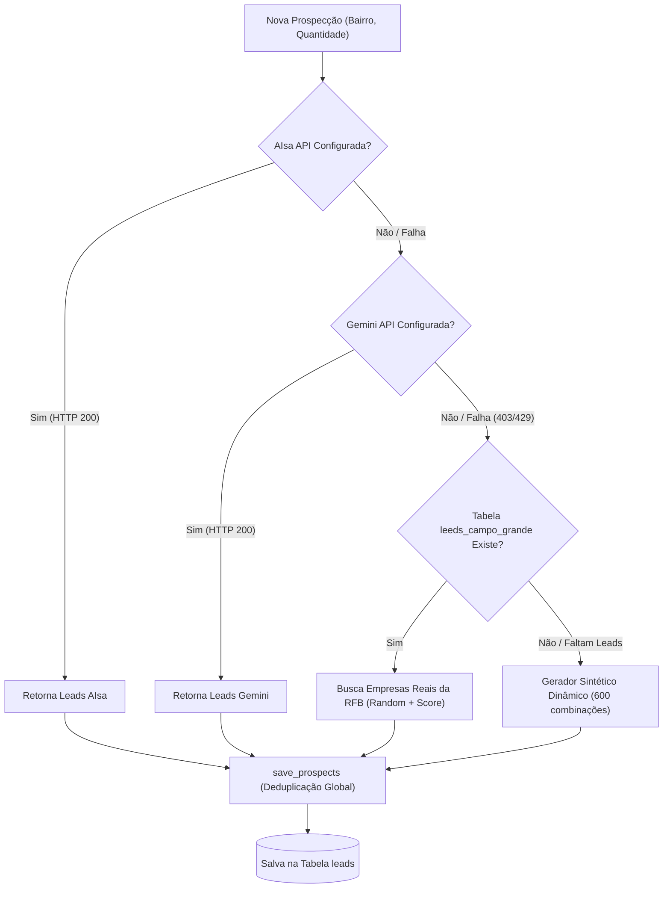

# AGENTS.md - Diretrizes de Desenvolvimento e Arquitetura do Workspace

Bem-vindo ao workspace do **DigitalNet MS - Radar de Leads & Sistema de Gestão**.
Este documento define as regras de desenvolvimento, catálogo de modelos de dados, motores de inteligência artificial, controle de acesso e regras espaciais obrigatórias para todos os agentes de IA atuando neste repositório.

---

## 1. Visão Geral do Sistema

A aplicação é uma plataforma completa de **Gestão Comercial, Controle de Acesso (RBAC) e Radar de Expansão de Telecomunicações** (ISP B2B) para a **DigitalNet MS** em Campo Grande - MS.
- **Stack:** Python 3.11+, Flask 3, Flask-SQLAlchemy, Flask-Migrate (Alembic), Flask-Login, Flask-WTF, Bootstrap 5.3, Mapbox GL JS / Leaflet.
- **Bancos de Dados:**
  - **SQLite Primário:** `instance/app_clientes.db` (armazenamento de Usuários, Grupos de Acesso, Clientes, Pedidos, Leads, Tabelas Espaciais e Base RFB).
  - **PostgreSQL + PostGIS (Opcional/Espacial):** `localhost:5432/db_geo` para análises espaciais avançadas (`ST_Intersects`).
- **Deploy Autônomo:** `setup.sh` (script bash auto-contido gerado via `scripts/gerar_setup.py`).

---

## 2. Catálogo de Modelos de Dados e Tabelas

### 2.1 Tabelas Transacionais da Aplicação
- **`usuarios` (`app/models/user.py`):** Usuários do sistema, perfil de acesso (`administrador`, `lider_tecnico`, `agente`), status de ativação, hash seguro com `werkzeug.security`.
- **`grupos` e `usuario_grupos` (`app/models/user.py`):** Grupos de acesso configuráveis com atribuição de papel (`papel`), descrição e relacionamento many-to-many com usuários para herança coletiva de permissões.
- **`clientes` (`app/models/cliente.py`):** Clientes corporativos e residenciais ativos com endereço, CEP e coordenadas.
- **`pedidos` e `itens_pedido` (`app/models/pedido.py`):** Pedidos comerciais vinculados a clientes, de 1 a 10 itens com totalização automática em centavos (`REAL`).
- **`leads` (`app/models/lead.py`):** Oportunidades comerciais de prospecção geo-localizada, com pontuação (`lead_score`), operadora atual (Vivo Fibra / Claro), dor operacional mapeada, roteiro WhatsApp anti-ban, dossiê comercial e vínculo de conversão (`cliente_convertido_id`).

### 2.2 Base de Inteligência da Receita Federal (RFB)
- **`leeds_campo_grande`:** Base de 158.558 empresas comerciais e prestadores de serviço ativos em Campo Grande - MS com CNPJ, CNAE, razão social, logradouro, número, bairro, complemento, telefone, decisor e CEP (`data/leeds_campo_grande.sql.gz`). Utilizada prioritariamente pelo motor de prospecção.

### 2.3 Camadas Geoespaciais Urbanas (SISGRAN / PLANURB)
Carregadas no SQLite via `scripts/carregar_geojson_sqlite.py` e `scripts/restaurar_imoveis.py` (ou PostGIS via `scripts/analisar_geojson_postgis.py`):
- **`geo_bairros`:** 74 bairros oficiais com geometria, macrozona e dados legais.
- **`geo_imoveis`:** 462.744 cadastros imobiliários urbanos completos de Campo Grande - MS com logradouro, número de porta, uso do imóvel, área de lote/edificada, geometria WGS84 e índice espacial R*Tree (`data/geo_imoveis.sql.gz`).
- **`geo_parcelamentos`:** 894 parcelamentos e loteamentos urbanos aprovados.
- **`geo_pd_macrozonas_urbanas`:** Macrozonas do Plano Diretor Municipal.

---

## 3. Controle de Acesso por Perfis (RBAC) e Painel Administrativo

O sistema implementa três perfis de acesso hierárquicos:
1. **Administrador (`administrador`):** Acesso irrestrito a todas as funcionalidades, incluindo o Painel de Administração de Usuários (`/admin/usuarios`), Grupos de Acesso (`/admin/grupos`), configurações gerais e exclusões.
2. **Líder Técnico (`lider_tecnico`):** Coordenação operacional e técnica com permissão para gerenciar clientes, pedidos, radar de leads e executar exclusões de clientes e pedidos.
3. **Agente (`agente`):** Operação comercial diária (prospecção de leads, abordagem WhatsApp, cadastro e edição de pedidos/clientes). Não possui acesso ao painel admin nem permissão para excluir registros críticos.

Decorators de autorização em `app/utils/auth_decorators.py`:
- `@admin_required`: Restringe o endpoint exclusivamente a Administradores.
- `@lider_required`: Restringe o endpoint a Líderes Técnicos e Administradores.
- `@perfil_required(*perfis)`: Permite múltiplos perfis autorizados.

---

## 4. Motores de Prospecção e Cascata de IA (`TelecomProspectorService`)

O serviço [`TelecomProspectorService`](file:///home/pizani/Projects/app_clientes/app/services/prospector.py) implementa uma cascata com failover automático:

---

## 5. SKILLs Disponíveis no Workspace

As skills do projeto residem em `.agents/skills/` e ensinam os procedimentos comprovados do repositório:
- **`enriquecer-prospectar-rfb` (`.agents/skills/enriquecer-prospectar-rfb/SKILL.md`):** Procedimento de enriquecimento e prospecção com a base de empresas da RFB, scripts anti-ban no WhatsApp e conversão em 1-clique.
- **`carregar-geojson-sqlite` (`.agents/skills/carregar-geojson-sqlite/SKILL.md`):** Carregamento de camadas GeoJSON e dump comprimido de 462k imóveis no SQLite com inferência de tipos, bounding boxes e indexação espacial R*Tree.

---

## 6. Comandos e Ferramentas Essenciais do Repositório

| Comando | Descrição |
| :--- | :--- |
| `.venv/bin/python -m unittest discover -s tests -v` | Executa a suíte de testes unitários automatizados. |
| `python scripts/carregar_geojson_sqlite.py --execute` | Carrega as camadas GeoJSON no SQLite com índices espaciais R*Tree. |
| `python scripts/restaurar_imoveis.py` | Restaura os 462.744 imóveis urbanos (`geo_imoveis`) a partir de `data/geo_imoveis.sql.gz`. |
| `python scripts/restaurar_rfb.py` | Restaura a base de empresas da RFB a partir de `data/leeds_campo_grande.sql.gz`. |
| `python scripts/enriquecer_clientes_rfb.py --limit 150` | Enriquece a tabela `clientes` com empresas reais da RFB. |
| `python scripts/gerar_perfis_sisgran.py` | Atualiza o dicionário de bairros em `app/data/perfis_sisgran.py`. |
| `python scripts/gerar_setup.py && python scripts/gerar_setup.py --check` | Regenera o instalador autônomo `setup.sh` e verifica integridade. |
| `python scripts/setup_agents.py` | Regenera este `AGENTS.md`, `README.md` e sincroniza as SKILLs. |

---

## 7. Regras de Conduta para Agentes de IA

1. **Evidência Antes de Afirmações:** Nunca declare uma alteração concluída sem rodar a suíte de testes (`unittest`) e confirmar código de saída 0.
2. **Integridade de Documentação:** Mantenha docstrings e comentários existentes.
3. **Não poluir setup.sh com dumps temporários:** O `setup.sh` deve incluir apenas arquivos essenciais versionados; dumps brutos de curl `.json` e arquivos gigantes (`geojson/imoveis.geojson`) devem ser ignorados no `.gitignore`.
4. **Isolamento de Conexão no SQLite :memory::** Em testes unitários com SQLite `:memory:`, NUNCA chame `inspect(db.engine)` diretamente, pois isso causa alocação de conexões separadas no pool e isola a sessão de teste. Utilize consultas diretas via `db.session`.
5. **Estratégia Blindada para POC:** O `setup.sh` foi projetado para recriar 100% do sistema em ambientes Ubuntu limpos em menos de 30 segundos, suportando execução offline (com `data/leeds_campo_grande.sql.gz` e `data/geo_imoveis.sql.gz` locais) ou online (via GitHub público sem autenticação).
