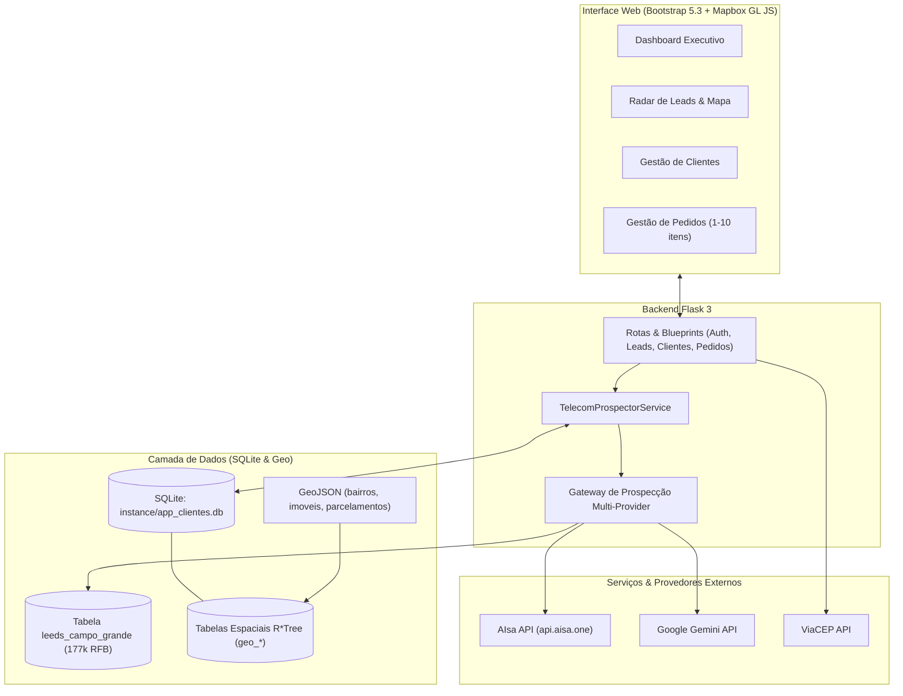

# 🚀 DigitalNet MS - Radar de Leads & Gestão Comercial Telecom

Sistema integrado de **Gestão Comercial, Prospecção Geo-Localizada e Expansão de Infraestrutura Óptica B2B** para a operadora **DigitalNet MS** em Campo Grande - MS.

Desenvolvido em **Python 3.11+ e Flask 3**, o sistema integra **Inteligência Artificial (AIsa e Gemini)**, dados geográficos oficiais do **SISGRAN / PLANURB**, mais de **21.000 feições urbanas** (bairros, imóveis e loteamentos) com indexação espacial **R*Tree** no SQLite e uma base de **177.614 empresas da Receita Federal do Brasil**.

---

## 📑 Sumário

- [Visão Geral e Diferenciais](#-visão-geral-e-diferenciais)
- [Arquitetura do Sistema](#-arquitetura-do-sistema)
- [Funcionalidades Principais](#-funcionalidades-principais)
- [Instalação Rápida com setup.sh](#-instalação-rápida-com-setupsh)
- [Motores de Prospecção e Inteligência Artificial](#-motores-de-prospecção-e-inteligência-artificial)
- [Dados Geoespaciais e SISGRAN](#-dados-geoespaciais-e-sisgran)
- [Base de 177k Empresas da Receita Federal](#-base-de-177k-empresas-da-receita-federal)
- [Scripts e Ferramentas CLI](#-scripts-e-ferramentas-cli)
- [Suíte de Testes](#-suíte-de-testes)
- [Agentes de IA e SKILLs](#-agentes-de-ia-e-skills)

---

## 🌟 Visão Geral e Diferenciais

- **Viabilidade Óptica Hiperlocal:** O sistema calcula clusters de clientes conectados por bairro de Campo Grande, permitindo prospectar empresas exatamente onde a fibra óptica da DigitalNet já está nos postes (AS61588).
- **Interatividade nos Nós Ópticos (Offcanvas):** Ao clicar em um nó de fibra no mapa, abre uma gaveta lateral listando as empresas reais daquele raio, com scores, WhatsApp anti-ban em 1-clique e navegação focada no mapa.
- **Interface Imersiva (Menu Recolhível & Mapa Fullscreen):** Barra lateral retrátil com persistência em `localStorage` e modo Tela Cheia no mapa com ajuste contínuo de tiles Leaflet.
- **Roteiro WhatsApp Anti-Ban com Opt-in:** Reduz o risco de bloqueio de número para quase zero com um método consultivo em 3 passos, oferecendo Wi-Fi 6 em comodato e pontos DigiMesh sem custos de aluguel.
- **Cascata Multi-Provedor de Prospecção:** Integração com a API AIsa (`asi1-mini`), Google Gemini AI, banco de dados abertos da RFB e gerador sintético de alta diversidade com mais de 600 combinações.
- **Banco Espacial Dual (SQLite R*Tree & PostGIS):** Análise e ingestão automática de 21.042 feições urbanas com bounding boxes e centróides tanto em SQLite puro quanto em PostgreSQL + PostGIS.
- **Conversão em 1-Clique:** Transforma um lead prospectado em Cliente e gera automaticamente o Pedido com planos reais da operadora (Fibra 600, 700 + DigiMesh, 900 Advanced e Link Dedicado Pro).
- **Deploy Autônomo Blindado (POC em 30s):** `setup.sh` auto-contido para demonstrações de POC, configurando todo o ambiente, as 21k feições urbanas e as 177k empresas da RFB em menos de 30 segundos (offline com pendrive ou online sem login).

---

## 🏗️ Arquitetura do Sistema



---

## 🚀 Funcionalidades Principais

### 1. Radar de Prospecção Geo-Localizada (`/leads/`)
- Mapa interativo com nós ópticos (clientes ativos) e oportunidades de leads com scores de conversão.
- Filtros por bairro oficial do SISGRAN (*Chácara Cachoeira, Centro, Santa Fé, Jardim dos Estados, etc.*).
- Dossiê comercial completo com perfil do decisor, dores de rede da concorrência e argumento de vendas.

### 2. Central WhatsApp & Abordagem Consultiva
- Script personalizado gerado sob demanda contendo gancho territorial, comparativo de plano e pedido explícito de opt-in.
- Botão de disparo direto via WhatsApp Web (`https://wa.me/...`).
- Tutor de Quebra de Objeções para SDRs com scripts imediatos contra fidelidade na concorrência, preço e comodismo.

### 3. Gestão Completa de Clientes e Pedidos
- CRUD de Clientes com preenchimento automático de CEP via ViaCEP e máscaras de CNPJ/Telefone.
- CRUD de Pedidos de 1 a 10 itens com totalização automática em tempo real e comprovante de impressão comercial.
- Dashboard executivo com métricas de faturamento, ticket médio e clientes ativos.

---

## 📦 Instalação Rápida com `setup.sh`

O projeto inclui o instalador autônomo `setup.sh`. Em um ambiente Linux limpo:

```bash
# 1. Dar permissão de execução:
chmod +x setup.sh

# 2. Executar a instalação automática (cria venv, dependências, banco e seed):
./setup.sh

# 3. Ativar o ambiente e iniciar a aplicação:
source .venv/bin/activate
flask run --host=0.0.0.0 --port=5000
```

---

## 🤖 Motores de Prospecção e Inteligência Artificial

O sistema implementa uma cascata de 4 camadas:
1. **AIsa API:** Suporte nativo ao endpoint `/v1/chat/completions` da AIsa com o modelo `asi1-mini`. Configuração via `AISA_API_KEY` no `.env`.
2. **Google Gemini:** Prospecção com modelo Gemini via `GEMINI_API_KEY`.
3. **Motor Local RFB (`leeds_campo_grande`):** Quando as chaves externas não estão presentes ou atingem limite de cota, o sistema seleciona empresas reais ativas de Campo Grande para o CEP do bairro.
4. **Gerador Sintético Dinâmico:** Combina 15 setores comerciais com 40 sobrenomes locais e garante que nenhum nome duplicado seja gerado.

---

## 🗺️ Dados Geoespaciais e SISGRAN

O sistema integra 4 arquivos GeoJSON oficiais em `geojson/`:
- `bairros.geojson`: 74 polígonos de bairros municipais.
- `imoveis.geojson`: 20.000 imóveis urbanos com numeração predial e ruas reais.
- `parcelamentos.geojson`: 894 loteamentos aprovados.
- `pd-macrozonas-urbanas.geojson`: Macrozonas urbanas do Plano Diretor.

### Carregando no SQLite com Suporte a R*Tree:
```bash
python scripts/carregar_geojson_sqlite.py --execute
```
Todas as feições são armazenadas com colunas de bounding box (`min_lng, min_lat, max_lng, max_lat`), centróides geométricos e indexação virtual R*Tree.

---

## 🏛️ Base de 177k Empresas da Receita Federal

O arquivo SQLite inclui a tabela `leeds_campo_grande` contendo 177.614 empresas de Campo Grande.
Para enriquecer a base de clientes distribuindo empresas reais pelos bairros:

```bash
# Enriquece a tabela clientes com 150 empresas reais da RFB:
python scripts/enriquecer_clientes_rfb.py --limit 150
```

---

## 🛠️ Scripts e Ferramentas CLI

| Script | Finalidade |
| :--- | :--- |
| `python scripts/carregar_geojson_sqlite.py --execute` | Carrega camadas GeoJSON no SQLite com índices espaciais R*Tree. |
| `python scripts/enriquecer_clientes_rfb.py` | Enriquece clientes com dados da Receita Federal e SISGRAN. |
| `python scripts/gerar_perfis_sisgran.py` | Atualiza o catálogo territorial em `app/data/perfis_sisgran.py`. |
| `python scripts/analisar_geojson_postgis.py --execute` | Importa os GeoJSONs para PostgreSQL + PostGIS (opcional). |
| `python scripts/gerar_setup.py` | Regenera o instalador autônomo `setup.sh`. |
| `python scripts/setup_agents.py` | Regenera `AGENTS.md`, `README.md` e instala as SKILLs. |

---

## 🧪 Suíte de Testes

O projeto possui **28 testes unitários** cobrindo autenticação, CRUDs de clientes e pedidos, totalização automática de itens, integridade de senhas do seed, rotas do radar de leads, geojson layers e prevenção estrita de leads duplicados:

```bash
.venv/bin/python -m unittest discover -s tests -v
```

---

## 🧠 Agentes de IA e SKILLs

As diretrizes detalhadas para LLMs e agentes de codificação estão estruturadas em:
- **`AGENTS.md`**: Regras de arquitetura, convenções e catalogo de tabelas.
- **`.agents/skills/enriquecer-prospectar-rfb/SKILL.md`**: Runbook completo para uso da base RFB e prospecção de ISP.
- **`.agents/skills/carregar-geojson-sqlite/SKILL.md`**: Guia para análise e consultas geoespaciais em SQLite com R*Tree.
