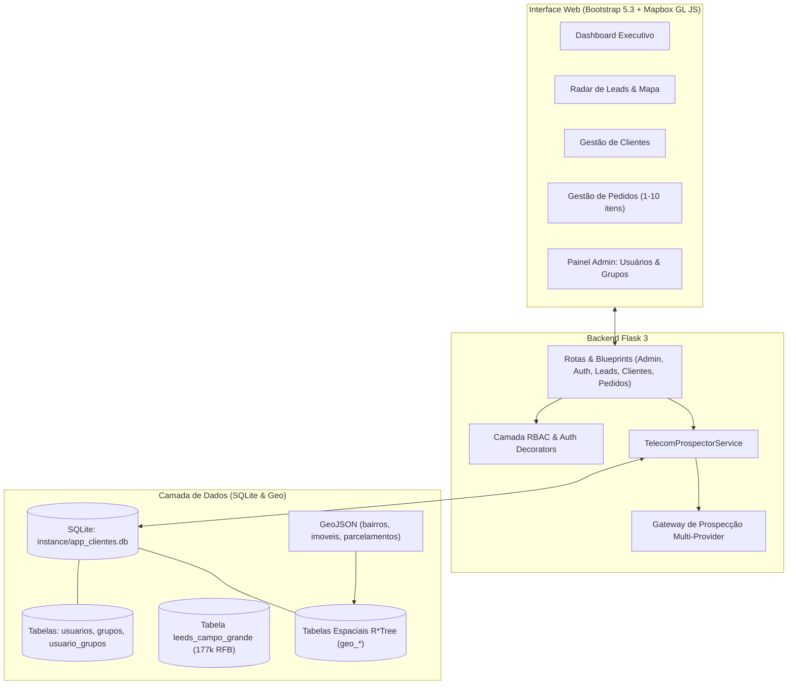

# DigitalNet MS - Radar de Leads, Gestão Comercial & Controle de Acesso (RBAC)

Sistema integrado de **Gestão Comercial, Controle de Acesso por Perfis & Grupos, Prospecção Geo-Localizada e Expansão de Infraestrutura Óptica B2B** para a operadora **DigitalNet MS** em Campo Grande - MS.

Desenvolvido em **Python 3.11+ e Flask 3**, o sistema integra **Controle de Acesso RBAC**, **Inteligência Artificial (AIsa e Gemini)**, dados geográficos oficiais do **SISGRAN / PLANURB**, mais de **21.000 feições urbanas** (bairros, imóveis e loteamentos) com indexação espacial **R*Tree** no SQLite e uma base de **177.614 empresas da Receita Federal do Brasil**.

---

## Sumário

- [Visão Geral e Diferenciais](#visao-geral-e-diferenciais)
- [Arquitetura do Sistema](#arquitetura-do-sistema)
- [Controle de Acesso e Perfis (RBAC)](#controle-de-acesso-e-perfis-rbac)
- [Funcionalidades Principais](#funcionalidades-principais)
- [Instalação Rápida com setup.sh](#instalacao-rapida-com-setupsh)
- [Motores de Prospecção e Inteligência Artificial](#motores-de-prospeccao-e-inteligencia-artificial)
- [Dados Geoespaciais e SISGRAN](#dados-geoespaciais-e-sisgran)
- [Base de 177k Empresas da Receita Federal](#base-de-177k-empresas-da-receita-federal)
- [Scripts e Ferramentas CLI](#scripts-e-ferramentas-cli)
- [Suíte de Testes](#suite-de-testes)
- [Agentes de IA e SKILLs](#agentes-de-ia-e-skills)

---

## Visão Geral e Diferenciais

- **Controle de Acesso por Perfis (RBAC):** Hierarquia de permissões estruturada para **Administrador**, **Líder Técnico** e **Agente**, além de grupos de trabalho customizáveis.
- **Painel Administrativo Completo:** Gestão centralizada de usuários (`/admin/usuarios`) com criação, edição de perfis, ativação/desativação e grupos de acesso (`/admin/grupos`).
- **Viabilidade Óptica Hiperlocal:** O sistema calcula clusters de clientes conectados por bairro de Campo Grande, permitindo prospectar empresas exatamente onde a fibra óptica da DigitalNet já está nos postes (AS61588).
- **Interatividade nos Nós Ópticos (Offcanvas):** Ao clicar em um nó de fibra no mapa, abre uma gaveta lateral listando as empresas reais daquele raio, com scores, WhatsApp anti-ban em 1-clique e navegação focada no mapa.
- **Interface Imersiva (Menu Recolhível & Mapa Fullscreen):** Barra lateral retrátil com persistência em `localStorage` e badges identificadores do perfil do operador.
- **Roteiro WhatsApp Anti-Ban com Opt-in:** Reduz o risco de bloqueio de número para quase zero com um método consultivo em 3 passos, oferecendo Wi-Fi 6 em comodato e pontos DigiMesh sem custos de aluguel.
- **Cascata Multi-Provedor de Prospecção:** Integração com a API AIsa (`asi1-mini`), Google Gemini AI, banco de dados abertos da RFB e gerador sintético de alta diversidade.
- **Banco Espacial Dual (SQLite R*Tree & PostGIS):** Análise e ingestão automática de 21.042 feições urbanas com bounding boxes e centróides tanto em SQLite puro quanto em PostgreSQL + PostGIS.
- **Conversão em 1-Clique:** Transforma um lead prospectado em Cliente e gera automaticamente o Pedido com planos reais da operadora.
- **Deploy Autônomo Blindado (POC em 30s):** `setup.sh` auto-contido para demonstrações de POC, configurando todo o ambiente em menos de 30 segundos.

---

## Arquitetura do Sistema



---

## Controle de Acesso e Perfis (RBAC)

| Perfil | Escopo e Responsabilidades | Acesso ao Painel Admin | Exclusão de Registros |
| :--- | :--- | :---: | :---: |
| **Administrador** | Gestão irrestrita do sistema, criação de usuários, auditoria, configurações e criação de grupos de acesso. | Sim (`/admin/`) | Sim |
| **Líder Técnico** | Supervisão técnica e comercial, gestão de clientes, pedidos, conversão e exclusão autorizada de cadastros. | Não | Sim |
| **Agente** | Operação comercial, prospecção geo-localizada, disparo consultivo WhatsApp, cadastro de clientes e pedidos. | Não | Não |

---

## Funcionalidades Principais

### 1. Painel de Administração de Usuários & Grupos (`/admin/`)
- Listagem completa com filtros por perfil, status ativo/inativo e grupo de trabalho.
- Cadastro de novos operadores com atribuição imediata de perfil e grupos associados.
- Edição cadastral, redefinição segura de senha e proteção estrita contra auto-exclusão ou exclusão do último administrador ativo.
- Criação e gerenciamento de grupos de acesso com papel herdado.

### 2. Radar de Prospecção Geo-Localizada (`/leads/`)
- Mapa interativo com nós ópticos (clientes ativos) e oportunidades de leads com scores de conversão.
- Filtros por bairro oficial do SISGRAN (*Chácara Cachoeira, Centro, Santa Fé, Jardim dos Estados, etc.*).
- Dossiê comercial completo com perfil do decisor, dores de rede da concorrência e argumento de vendas.

### 3. Central WhatsApp & Abordagem Consultiva
- Script personalizado gerado sob demanda contendo gancho territorial, comparativo de plano e pedido explícito de opt-in.
- Botão de disparo direto via WhatsApp Web (`https://wa.me/...`).

### 4. Gestão Completa de Clientes e Pedidos
- CRUD de Clientes com preenchimento automático de CEP via ViaCEP e máscaras de CNPJ/Telefone.
- CRUD de Pedidos de 1 a 10 itens com totalização automática em tempo real e comprovante de impressão comercial.
- Dashboard executivo com métricas de faturamento, ticket médio e clientes ativos.

### 5. Tabelas Interativas com DataTables Responsive e Linhas Aninhadas
- **DataTables 2 & Extensão Responsive:** As tabelas de Clientes (/clientes/) e Leads (/leads/) adaptam-se com fluidez a qualquer resolução de tela (desktop, tablet e mobile).
- **Linhas Aninhadas (Child Rows com Subtabelas):** O botão interativo Detalhes expande painéis avançados sob demanda:
  - *Tabela de Clientes:* Dossiê cadastral, endereço completo, total gasto acumulado e subtabela aninhada com o histórico de pedidos conectados e atalhos rápidos de WhatsApp.
  - *Tabela de Leads:* Acordeão técnico com inteligência territorial de Campo Grande (CTO no quarteirão), script anti-ban para WhatsApp com botão de cópia de 1 clique, e pacote recomendado DigitalNet com botão de conversão imediata em cliente.

---

## Instalação Rápida com `setup.sh`

```bash
# 1. Dar permissão de execução:
chmod +x setup.sh

# 2. Executar a instalação automática (cria venv, dependências, banco e seed):
./setup.sh

# 3. Ativar o ambiente e iniciar a aplicação:
source .venv/bin/activate
flask run --host=0.0.0.0 --port=5000
```

### Credenciais de Acesso Exibidas ao Final do Setup

Ao concluir a instalação, o `setup.sh` exibe um resumo final destacado com os usuários e senhas prontos para uso (a senha gerada para o admin é preservada em `instance/.admin_password` e não se perde no log):

| Perfil | Usuário | Senha Padrão | Observações |
| :--- | :--- | :--- | :--- |
| **Administrador** | `admin` | *Exibida no resumo final* | Gerada dinamicamente ou definida via `SEED_ADMIN_PASSWORD=... ./setup.sh` |
| **Líder Técnico** | `lider.tecnico` | `Lider#2026` | Supervisão técnica e aprovação operacional |
| **Agente Comercial** | `agente.comercial` | `Agente#2026` | Operação de prospecção e abordagem WhatsApp |

---

## Scripts e Ferramentas CLI

| Script | Finalidade |
| :--- | :--- |
| `python scripts/carregar_geojson_sqlite.py --execute` | Carrega camadas GeoJSON no SQLite com índices espaciais R*Tree. |
| `python scripts/enriquecer_clientes_rfb.py` | Enriquece clientes com dados da Receita Federal e SISGRAN. |
| `python scripts/gerar_perfis_sisgran.py` | Atualiza o catálogo territorial em `app/data/perfis_sisgran.py`. |
| `python scripts/analisar_geojson_postgis.py --execute` | Importa os GeoJSONs para PostgreSQL + PostGIS (opcional). |
| `python scripts/gerar_setup.py` | Regenera o instalador autônomo `setup.sh`. |
| `python scripts/setup_agents.py` | Regenera `AGENTS.md`, `README.md` e instala as SKILLs. |
| `python scripts/gravar_demonstracao.py` | Grava vídeo automatizado de demonstração completa com Playwright. |

---

## Suíte de Testes

O projeto possui **53 testes unitários** cobrindo autenticação, controle de acesso RBAC, administração de usuários e grupos, catálogo e CRUD de planos de banda larga (PF/PJ), CRUDs de clientes e pedidos, totalização automática de itens, integridade de senhas do seed, rotas do radar de leads, geojson layers e prevenção de leads duplicados:

```bash
.venv/bin/python -m unittest discover -s tests -v
```

---

## Agentes de IA e SKILLs

As diretrizes detalhadas para LLMs e agentes de codificação estão estruturadas em:
- **`AGENTS.md`**: Regras de arquitetura, convenções e catalogo de tabelas.
- **`.agents/skills/enriquecer-prospectar-rfb/SKILL.md`**: Runbook completo para uso da base RFB e prospecção de ISP.
- **`.agents/skills/carregar-geojson-sqlite/SKILL.md`**: Guia para análise e consultas geoespaciais em SQLite com R*Tree.
