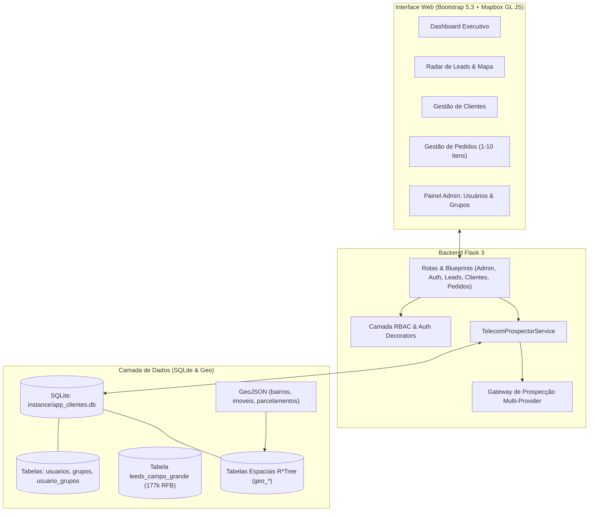

# DigitalLeads

Sistema integrado de CRM, Gestão de Pedidos e Prospecção B2B Geo-localizada para a DigitalNet Telecomunicações (Campo Grande-MS), enriquecido com inteligência territorial de camadas GeoJSON (SISGRAN / PLANURB) e a base de 177.614 empresas ativas da Receita Federal do Brasil (RFB).


<div align="center" >
<p align="center">  
  <a href="#">
    
  </a>  
</p>
</div>

---

## Funcionalidades Principais 

### 1. Radar de Leads & Expansão de Rede Óptica
- Mapa interativo com círculos térmicos de cobertura e nós de fibra óptica (CTO) em bairros de Campo Grande (Chácara Cachoeira, Centro, Santa Fé, Carandá Bosque, etc.).
- Carregamento sob demanda de camadas GeoJSON oficiais do município: Bairros, Macrozonas Urbanas e Parcelamentos do Plano Diretor da Lei de Uso do Solo de Campo Grande.
- Prospecção de empresas vizinhas a nós de rede em 1 clique, com busca na base da Receita Federal por proximidade de CEP.
- Carregamento de empresas ativas diretamente no raio de cobertura do nó através de gaveta lateral (Offcanvas) com visualização em cards e mapa.

### 2. Dossiê 360° do Lead & Qualificação com IA
- Cálculo automático de viabilidade técnica no poste e Lead Score (0 a 100).
- Tutor de Quebra de Objeções (SDR Telecom) para contornar objeções de preço, fidelidade contratual com Vivo/Claro e receio técnico.
- Dossiê comercial completo com perfil do decisor, dores de rede da concorrência e argumento de vendas.
- Integração com a API AIsa de Leads, Google Gemini AI, banco de dados abertos da RFB e gerador sintético de alta diversidade.

### 3. Central WhatsApp & Abordagem Consultiva
- Script personalizado gerado sob demanda contendo gancho territorial, comparativo de plano e pedido explícito de opt-in.
- Botão de disparo direto via WhatsApp Web (`https://wa.me/...`).

### 4. Gestão Completa de Clientes e Pedidos
- CRUD de Clientes com preenchimento automático de CEP via ViaCEP e máscaras de CNPJ/Telefone.
- CRUD de Pedidos de 1 a 10 itens com totalização automática em tempo real e comprovante de impressão comercial.
- Dashboard executivo com métricas de faturamento, ticket médio e clientes ativos.

### 5. Catálogo e Gestão de Planos de Banda Larga (PF & PJ)
- **Painel Administrativo (/admin/planos):** Interface completa para cadastrar, editar, ativar/desativar e excluir planos de internet fibra oferecidos pela operadora.
- **Planos Residenciais (Pessoa Física):** Baseados no catálogo oficial (https://digitalnetms.com.br/clientepf/), cobrindo de 600 a 900 Mega com roteadores Wi-Fi 6, pontos DigiMesh, Skeelo e aplicativos de streaming (Grade Standard e Grade Top).
- **Planos Corporativos (Pessoa Jurídica):** Baseados nos Combos DigiCorp (https://digitalnetms.com.br/clientepj/), cobrindo 500 a 900 Mega com telefonia digital ilimitada, Tronco SIP (2 a 4 linhas simultâneas), PABX Virtual em nuvem (até 5 ramais + URA personalizada), IP fixo válido e SLA garantido em contrato (12h a 24h).
- **Sincronização em 1-Clique:** Botão para restaurar e sincronizar os 9 planos oficiais diretamente da base padrão.

---


## Arquitetura do Sistema



---

## Controle de Acesso e Perfis (RBAC)

| Perfil | Escopo e Responsabilidades | Acesso ao Painel Admin | Exclusão de Registros |
| :--- | :--- | :---: | :---: |
| **Administrador** | Gestão irrestrita do sistema, criação de usuários, auditoria, configurações e criação de grupos de acesso. | Sim (`/admin/`) | Sim |
| **Líder Técnico** | Supervisão técnica e comercial, gestão de clientes, pedidos, conversão e exclusão autorizada de cadastros. | Não | Sim |
| **Agente** | Operação comercial, prospecção geo-localizada, disparo consultivo WhatsApp, cadastro de clientes e pedidos. | Não | Não |


---

## Instalação Rápida com `setup.sh`

```bash
# 1. Dar permissão de execução:
chmod +x setup.sh

# 2. Executar a instalação automática (cria venv, dependências, banco e seed):
./setup.sh

# 3. Ativar o ambiente e iniciar a aplicação:
source .venv/bin/activate
flask run --host=0.0.0.0 --port=5000
```

### Credenciais de Acesso Exibidas ao Final do Setup

Ao concluir a instalação, o `setup.sh` exibe um resumo final destacado com os usuários e senhas prontos para uso (a senha gerada para o admin é preservada em `instance/.admin_password` e não se perde no log):

| Perfil | Usuário | Senha Padrão | Observações |
| :--- | :--- | :--- | :--- |
| **Administrador** | `admin` | *Exibida no resumo final* | Gerada dinamicamente ou definida via `SEED_ADMIN_PASSWORD=... ./setup.sh` |
| **Líder Técnico** | `lider.tecnico` | `Lider#2026` | Supervisão técnica e aprovação operacional |
| **Agente Comercial** | `agente.comercial` | `Agente#2026` | Operação de prospecção e abordagem WhatsApp |

---

## Scripts e Ferramentas CLI

| Script | Finalidade |
| :--- | :--- |
| `python scripts/carregar_geojson_sqlite.py --execute` | Carrega camadas GeoJSON no SQLite com índices espaciais R*Tree. |
| `python scripts/enriquecer_clientes_rfb.py` | Enriquece clientes com dados da Receita Federal e SISGRAN. |
| `python scripts/gerar_perfis_sisgran.py` | Atualiza o catálogo territorial em `app/data/perfis_sisgran.py`. |
| `python scripts/analisar_geojson_postgis.py --execute` | Importa os GeoJSONs para PostgreSQL + PostGIS (opcional). |
| `python scripts/gerar_setup.py` | Regenera o instalador autônomo `setup.sh`. |
| `python scripts/setup_agents.py` | Regenera `AGENTS.md`, `README.md` e instala as SKILLs. |

---

## Suíte de Testes

O projeto possui **53 testes unitários** cobrindo autenticação, controle de acesso RBAC, administração de usuários e grupos, catálogo e CRUD de planos de banda larga (PF/PJ), CRUDs de clientes e pedidos, totalização automática de itens, integridade de senhas do seed, rotas do radar de leads, geojson layers e prevenção de leads duplicados:

```bash
.venv/bin/python -m unittest discover -s tests -v
```

---

## Agentes de IA e SKILLs

As diretrizes detalhadas para LLMs e agentes de codificação estão estruturadas em:
- **`AGENTS.md`**: Regras de arquitetura, convenções e catalogo de tabelas.
- **`.agents/skills/enriquecer-prospectar-rfb/SKILL.md`**: Runbook completo para uso da base RFB e prospecção de ISP.
- **`.agents/skills/carregar-geojson-sqlite/SKILL.md`**: Guia para análise e consultas geoespaciais em SQLite com R*Tree.
